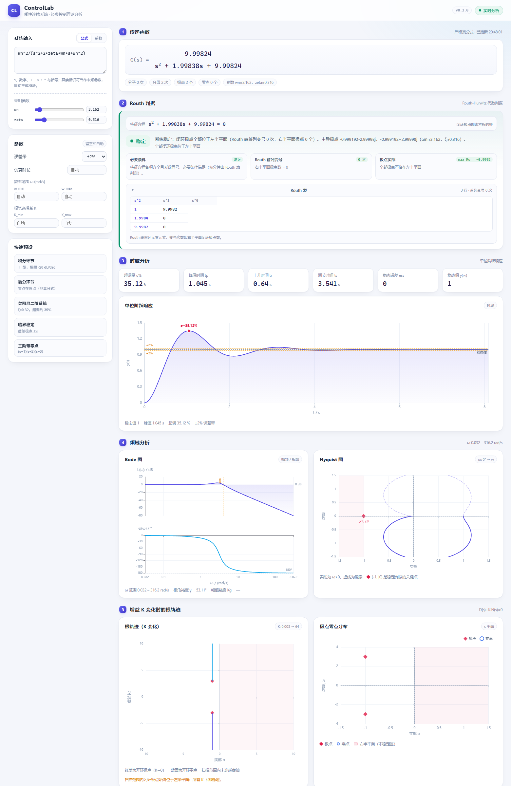
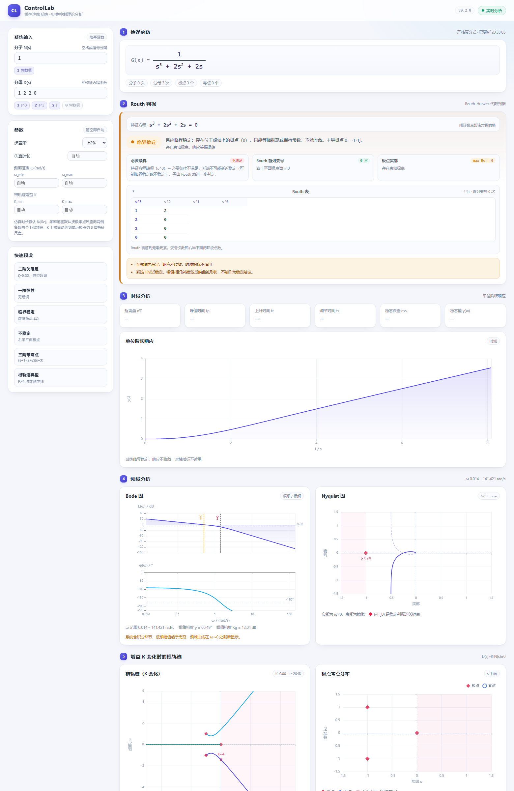
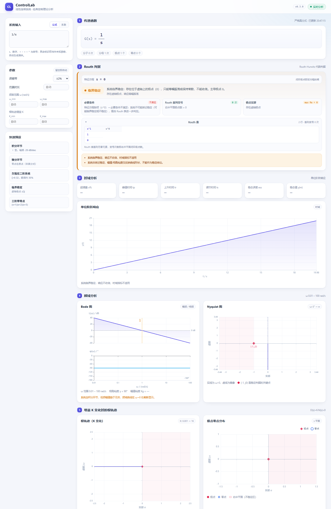

# ControlLab

面向《自动控制原理》初学者的轻量分析工具 —— 直接写传递函数表达式（可含未知参数），立刻得到稳定性判据、时域响应、Bode/Nyquist 曲线与增益 K 变化时的根轨迹。

目标是替代 MATLAB 在本课程中的「看一眼系统行为」这一场景：不需要写代码、不需要 license、打开就能用。



## 已实现的功能（v0.3.0）

分析区按固定顺序展开：**传递函数 → Routh 判据 → 时域分析 → 频域分析 → 根轨迹**。

| 分块 | 内容 |
| --- | --- |
| 公式编辑器 | 直接写 `wn^2/(s^2+2*zeta*wn*s+wn^2)` 或 `K/(s*(s+1))`；未识别的标识符自动变成未知参数，并生成滑块实时调节 |
| 传递函数 | 自动化简为分子/分母多项式，去前导 0、识别真分式、非真分式自动做多项式除法；也可切到「系数」模式直接填降幂系数 |
| Routh 判据 | 特征方程 D(s)=0、Routh-Hurwitz 表（精确分数 + ε 法 + 全零行特判）、必要条件、极点实部，三重依据互相校验 |
| 时域分析 | 单位阶跃响应曲线 + 超调量 σ%、峰值时间 tp、上升时间 tr、调节时间 ts、稳态误差 ess、稳态值 y(∞) |
| 频域分析 | Bode 图（幅频 + 相频，对数频率轴，标出 ωc、ωg、0 dB 与 -180°）、Nyquist 图（实线 ω>0、虚线镜像、标注临界点 (-1, j0)）、相角裕度 γ、幅值裕度 Kg |
| 根轨迹 | 解 D(s)+K·N(s)=0 扫 K，最近邻跟踪分支；标出开环极点/零点、右半平面着色、虚轴穿越点与临界增益 K；同一区域附极点零点分布图 |



## 左侧「系统输入 + 参数」区

### 公式模式（默认）

```
wn^2/(s^2+2*zeta*wn*s+wn^2)
```

- 支持 `s`、数字、`+ - * / ^`、括号，以及隐式乘法（`2s`、`3(s+1)` 都可以）
- 字母标识符自动识别为**未知参数**，出现滑块：拖动即重新计算全部结果；右侧数字框可键入任意精确值
- 滑块的默认范围按参数名猜（`zeta` → 0–2，`wn` → 0.1–50，`K` → 0–100），超出范围会自动扩展
- 切到「系数」模式时，会把当前解析出的分子/分母系数填进去，两种输入方式随时互换

### 预设（5 个）

| 预设 | 表达式 | 说明 |
| --- | --- | --- |
| 积分环节 | `1/s` | Ⅰ 型，幅频 -20 dB/dec |
| 微分环节 | `s` | 零点在原点（非真分式） |
| 欠阻尼二阶系统 | `wn^2/(s^2+2*zeta*wn*s+wn^2)` | ζ=0.32，超调约 35% |
| 临界稳定 | `4/(s^2+4)` | 虚轴极点 ±2j |
| 三阶带零点 | `(s+1)/(s^3+6*s^2+11*s+6)` | (s+1)(s+2)(s+3) |



### 其他参数

- 调节时间误差带（±2% / ±5% / ±10%）
- 仿真时长 t_end（留空自动）
- 频率范围 ω_min / ω_max（留空自动，默认按极零点尺度向两侧各取两个十倍频程）
- 根轨迹增益范围 K_min / K_max（留空自动，默认扫到最远闭环极点约 8 倍特征尺度）

## 快速开始

### 方式一：桌面窗口（推荐给使用者）

```powershell
cd E:\PY_Projects\Project4\ControlLab

# 首次需要构建前端（已构建可跳过）
cd frontend; npm install; npm run build; cd ..

# 启动
backend\.venv\Scripts\python.exe desktop\launcher.py
```

启动器会：挑一个空闲端口 → 起后端 → 轮询 `/health` → 打开 Edge 应用窗口 → 关闭窗口后回收后端进程。

### 方式二：前后端分开跑（推荐给开发）

```powershell
# 终端 1：后端
cd E:\PY_Projects\Project4\ControlLab\backend
.venv\Scripts\python.exe -m uvicorn app.main:app --reload --port 8000

# 终端 2：前端（Vite 已把 /api 代理到 8000）
cd E:\PY_Projects\Project4\ControlLab\frontend
npm run dev
```

浏览器打开 http://127.0.0.1:5173 。也可以用 URL 直接带参数：`?num=10&den=1%202%2010`（系数模式）或 `?formula=K%2F(s*(s%2B1))`（公式模式）。

### 命令行自检

```powershell
cd E:\PY_Projects\Project4\ControlLab\backend
.venv\Scripts\python.exe -m pytest
```

## 项目结构

```
ControlLab/
├─ backend/
│  ├─ app/
│  │  ├─ main.py                # FastAPI 入口，托管前端 dist
│  │  ├─ api/routes.py          # POST /api/v1/analyze
│  │  ├─ schemas/analysis.py    # 请求/响应模型
│  │  ├─ core/
│  │  │  ├─ polynomial.py       # 系数清洗、精确分数、多项式格式化
│  │  │  ├─ formula.py          # 表达式解析（s + 未知参数）→ 分子/分母系数
│  │  │  ├─ transfer_function.py# 传递函数、极点零点、真分式分解
│  │  │  ├─ stability.py        # Routh 表、必要条件、根实部判据
│  │  │  ├─ time_response.py    # 阶跃仿真与时域指标
│  │  │  ├─ frequency_response.py # Bode / Nyquist 数据与稳定裕度
│  │  │  └─ root_locus.py       # 根轨迹扫 K、分支跟踪、临界增益
│  │  └─ services/analyzer.py   # 编排：一次请求组装全部结果
│  └─ tests/                    # 47 个用例（公式解析、Routh 特例、指标理论值、频域、根轨迹、API）
├─ frontend/
│  └─ src/
│     ├─ App.tsx                # 左侧参数区 + 右侧五段式分析区
│     ├─ components/            # 公式编辑、参数滑块、稳定性、四类图、指标卡
│     ├─ hooks/useAnalysis.ts   # 防抖请求 + 结果缓存 + 取消
│     ├─ api/client.ts          # fetch 封装
│     └─ types/analysis.ts      # 与后端一致的类型定义
├─ desktop/launcher.py          # 端口分配 + 后端托管 + Edge 窗口
└─ docs/                        # 架构、API、开发环境记录
```

## 设计要点

- **公式解析用 sympy，但不做 simplify**：先用幂等变换把 `^` 换成 `**`、把每个标识符预注册成符号（否则隐式乘法会把 `wn` 拆成 `w*n`），再 `together + fraction` 取分子分母。**故意不用 `simplify`**——它会把分子分母的公因子约掉，`(s+1)/(s³+6s²+11s+6)` 会被化简成 `1/((s+2)(s+3))`，与用户输入不符。
- **判据不依赖浮点**：Routh 表用 `fractions.Fraction` → `sympy.Rational` 精确计算，`0.1/0.2` 这类输入不会因为浮点误差出现假变号；由公式产生的小数系数在表格里显示为小数而不是 `2499561/250000`。
- **两种独立性交叉验证**：稳定性同时给 Routh 变号次数与极点实部结论，二者不一致时在 warnings 里提示。
- **根轨迹是真解方程**：每个 K 解 `D(s)+K·N(s)=0`，再用最近邻匹配把根串成连续分支；临界增益由「最大实部穿零」插值得到，与 Routh 结果一致。
- **频域用 scipy 直接求值**：`H(jω)` 在 log 频率网格上求值，相位 `unwrap` 后转角度；稳定裕度由 0 dB / -180° 穿越点在对数频率上插值。
- **不收敛就不硬算**：不稳定/临界稳定时，时域指标直接标记为「不适用」，避免给出误导性数字。

## 后续路线

- 系统结构框图编辑（React Flow）与 Mason 增益公式求解
- 根轨迹与 Bode 的联动游标（拖动看 K / ω 对应的边界）
- 零极点对消提示、二阶近似判据
- PyInstaller 打包为单文件 exe

## 已知限制

- 只支持实系数、线性连续系统（SISO）。
- 时域指标基于数值仿真，采样 900 点后降采样到 600 点，分辨率对极快系统（时间常数 < 1 ms）偏低。
- 根轨迹只画增益 K 从 0→∞ 的正向分支，不含参数根轨迹（如某系数变化）。
- 桌面外壳依赖本机 Microsoft Edge。
